<!-- Generated by scripts/render_cards.py. Edit profile.json, then render. -->

About these cards

Self-contained SVGs, refreshed daily from GitHub. [Build and preview instructions](docs/cards.md).

